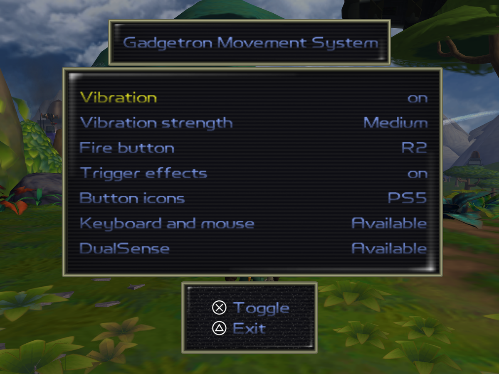
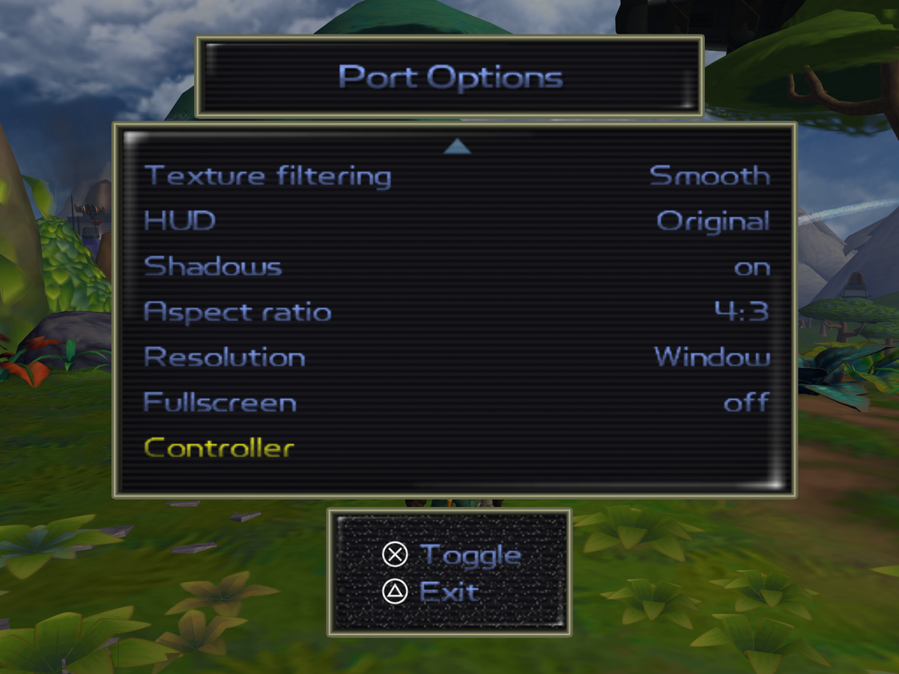
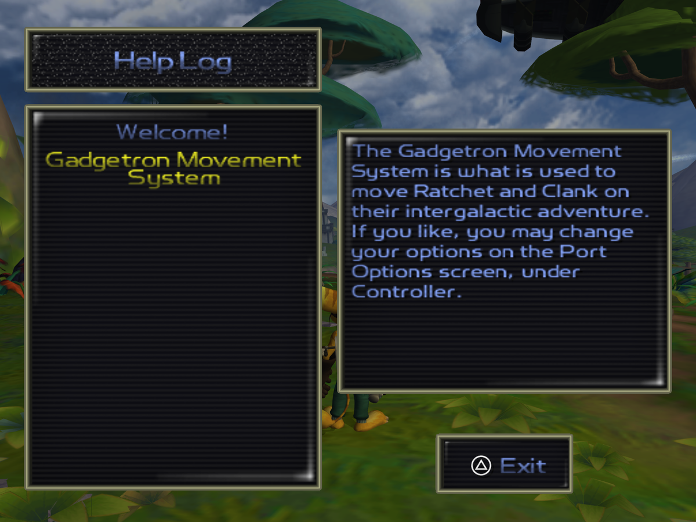
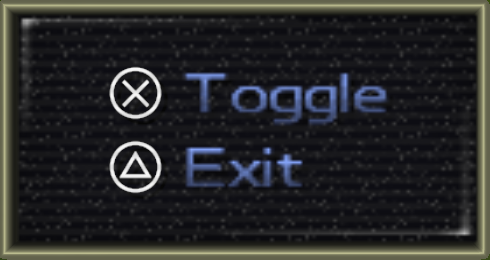
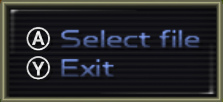

# DualSense for ReRAC

Native PS5 DualSense support for [ReRAC](https://github.com/re-rac/rerac), the native PC port of Ratchet & Clank (2002):
it reads the controller directly, adds rumble, and gives R2 adaptive-trigger feedback per weapon.

> **ReRAC is made by the [ReRAC contributors](https://github.com/re-rac/rerac).** This project only adds DualSense
> support on top of it. It is not part of ReRAC and not affiliated with the ReRAC team, Sony Interactive Entertainment
> or Insomniac Games. You need ReRAC and your own copy of the game; no game files are included here.

## Features

- **Plug and play over USB or Bluetooth.** No DS4Windows, DualSenseX or Steam Input needed. This also works after
  those tools have switched a Bluetooth DualSense into its "extended" mode, which stops ReRAC from seeing the
  controller at all. Every connected controller counts, so a virtual Xbox pad from those tools works too.
- **Rumble** from what happens in the game: wrench hits (jump attacks included), taking damage, firing, hard landings,
  explosions and other camera shakes. Every hit is its own short pulse, so quick combos are each felt.
- **R2 as the fire button** (optional). R1 still crouches.
- **Adaptive triggers per weapon**, synced to when the game fires. Each weapon fires at the point in the pull where
  its feel kicks in:

| Weapon | R2 feel |
|---|---|
| Walloper, Devastator | Heavy sniper-style click: a stiff wall that snaps, then the shot |
| Bomb Glove, Visibomb, Mine Glove, Glove of Doom, Decoy Glove | Lighter click |
| Blaster | Light resistance and a kick with every shot |
| R.Y.N.O. | Heavy buzz through the whole seven-missile salvo, plus full rumble per shot |
| Pyrocitor, Tesla Claw, Morph-o-Ray | A hum or buzz while firing |
| Suck Cannon, Taunter, Drone Device | Steady resistance |

The trigger goes slack with the wrench, with gadgets, when a weapon is out of ammo, and in menus.

- **Gadgetron Movement System** (new in 1.1.0, idea by roxas997): a Controller page that lists every connected
  controller (keyboard, DualSense, other pads), shows which one is active, and can lock the game to one of them.
- **Button icons** (new in 1.1.0): the game's on-screen button prompts as the PS2's, a PS5's or an Xbox One's, or
  Auto (follows the controller you last used). The PS5 and Xbox icons are drawn sharp at your screen's resolution.
- **Lightbar** (new in 1.1.1): leave it to the controller, turn it off, pick orange, green or blue, or let it follow
  Ratchet's health from green to red.

## Settings

Everything is in **Options → Port Options → Controller**, in both the main menu and the pause menu. It is saved with
ReRAC's other settings.

| Row | Values |
|---|---|
| Vibration | On / Off |
| Vibration strength | Low / Medium / High (changing it plays a short test pulse) |
| Fire button | Circle (the game's default) / R2 |
| Trigger effects | On / Off (needs Fire button: R2) |
| Button icons | Original / PS5 / Xbox One / Auto |
| Lightbar | Default (the controller's own) / Off / Orange / Green / Blue / Health |

Below the settings, the page lists the connected controllers as **Active** (last used) or **Available**. Press ✕ on
one to lock the game to it, and again to unlock.

In a new game, the HelpDesk explains the Gadgetron Movement System on Veldin. After that, the note stays in
**Help → Help Log**.

**Button icons:** PS5 and Xbox One

## Install

Needs **ReRAC 0.3.7** installed by the [ReRAC Launcher](https://github.com/re-rac/rerac-launcher), on Windows x64.
Still on ReRAC 0.3.6? Use [DualSense 1.1.2](https://github.com/thrivetoday/dualsense-for-rerac/releases/tag/v1.1.2)
instead: each DualSense zip is built for one ReRAC version, and its installer checks.

1. Download `ReRAC-DualSense-1.2.1.zip` from [Releases](https://github.com/thrivetoday/dualsense-for-rerac/releases/latest).
2. Close ReRAC, unzip, and run `install.bat`. It finds the game where the ReRAC Launcher put it (it reads the
   launcher's settings). If it can't, a Windows file window opens: select your `rerac.exe`. You can also drop your
   `rerac.exe`, your ReRAC folder or the ReRAC Launcher onto `install.bat`.
3. Start ReRAC from the launcher as usual.

ReRAC has no mod loader yet, so this ships as a replacement `rerac.exe`: the official 0.3.7 with the DualSense code
built in. `install.bat` copies it into your ReRAC 0.3.7 folder (by default
`%LOCALAPPDATA%\rerac\versions\official\v0.3.7-alpha\`), keeps the original as `rerac.exe.original`, and remembers
the folder for updates and `uninstall.bat`. Nothing else in your install changes.

**Uninstall:** run `uninstall.bat`, or reinstall 0.3.7 from the launcher. A newer official ReRAC version installs
into its own folder and won't include this until this project is updated for it.

## Good to know

- Over Bluetooth, the first rumble, trigger effect or lightbar colour switches the controller into the extended mode
  Steam uses. Other games that read it through Windows may not see it until you turn the controller off and on (hold PS for
  10 seconds, then press PS).
- It uses the DualSense's standard rumble motors. The finer "HD haptics" only work over USB through the controller's
  audio channel, so they are not used.
- The controller only works while the game's window is focused, like other controllers.
- After setting the lightbar back to Default, the controller keeps the last colour until you turn it off and on.
- This is for the official ReRAC 0.3.7, not for other ReRAC mods such as Weapon Evolution.
- Found a bug or have an idea? [Open an issue](https://github.com/thrivetoday/dualsense-for-rerac/issues/new/choose):
  the form asks for what's needed to fix it.

## How it works

The change is in [`patch/dualsense-haptics.patch`](patch/dualsense-haptics.patch), against ReRAC v0.3.7 (commit
`f2dfbb8`). The same changes for v0.3.6 are on the [`dualsense-haptics` branch](https://github.com/thrivetoday/rerac/tree/dualsense-haptics)
of a ReRAC fork.

- `dualsense.rs` reads the controller's HID reports (USB, Bluetooth simple and extended) through `hid.dll` and
  writes its output report: the rumble motors and R2's trigger effect.
- `haptics.rs` turns game state into rumble pulses and picks R2's effect from the weapon in hand. The RYNO's salvo
  and the Blaster's shots come from the game's own firing code.
- `input_map.rs` merges all controllers and reads R2's travel as fire.
- `gms.rs` tracks the connected controllers and the lock; the Controller page is in `rc-game`'s `menus/pause/port.rs`.
- `button_icons.rs` redraws the icon cells in the game's font texture, and for PS5 / Xbox draws each icon as a sharp
  image over the game's 512×416 2D layer.

To build it yourself, check out ReRAC at v0.3.7, run `git am patch/dualsense-haptics.patch`, and follow ReRAC's
README.

## Credits

- ReRAC: the [ReRAC contributors](https://github.com/re-rac/rerac).
- Gadgetron Movement System idea: roxas997 (ReRAC Discord).
- Button icons: "PS5 Button Icons and Controls" and "Xbox Series Button Icons and Controls" by
  [Zacksly](https://zacksly.itch.io), licensed under [CC BY 3.0](https://creativecommons.org/licenses/by/3.0/).
  Modified: scaled to the text's size and tinted with its colour in game.

## License

ISC, like ReRAC. See [LICENSE](LICENSE). The button icons are CC BY 3.0 (see Credits).
