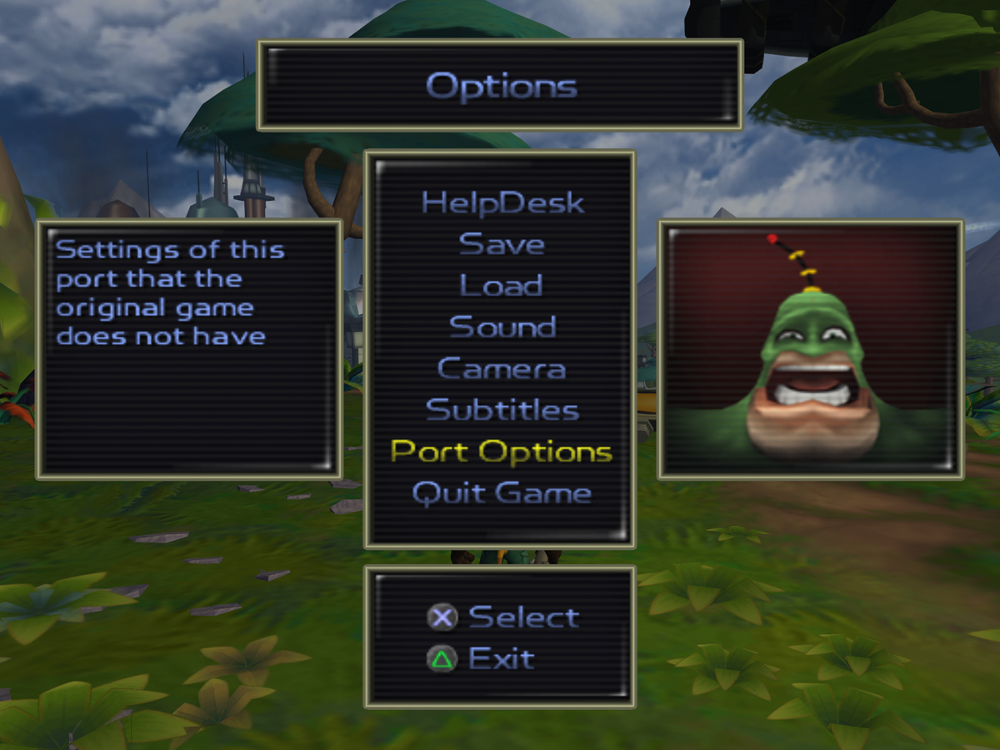
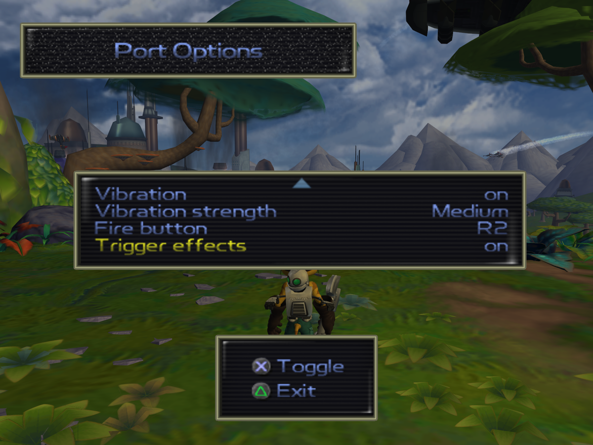
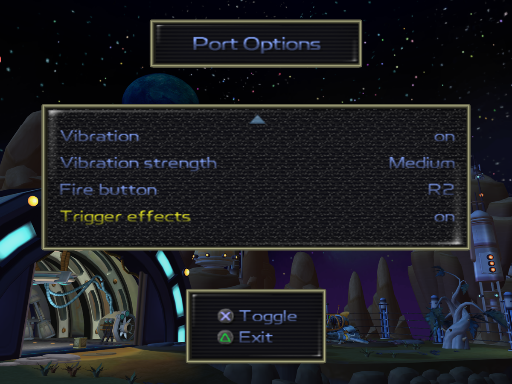

# DualSense for ReRAC

Native PS5 DualSense support for [ReRAC](https://github.com/re-rac/rerac), the native PC port of Ratchet & Clank (2002):
it reads the controller directly, adds rumble, and gives R2 adaptive-trigger feedback per weapon.

> **ReRAC is made by the [ReRAC contributors](https://github.com/re-rac/rerac).** This project only adds DualSense
> support on top of it. It is not part of ReRAC and not affiliated with the ReRAC team, Sony Interactive Entertainment
> or Insomniac Games. You need ReRAC and your own copy of the game; no game files are included here.

## Features

- **Plug and play over USB or Bluetooth.** No DS4Windows, DualSenseX or Steam Input needed. This also works after
  those tools have switched a Bluetooth DualSense into its "extended" mode, which stops ReRAC from seeing the
  controller at all. Every connected controller counts, so a virtual Xbox pad from those tools works too.
- **Rumble** from what happens in the game: wrench hits (jump attacks included), taking damage, firing, hard landings,
  explosions and other camera shakes. Every hit is its own short pulse, so quick combos are each felt.
- **R2 as the fire button** (optional). R1 still crouches.
- **Adaptive triggers per weapon**, synced to when the game fires. Each weapon fires at the point in the pull where
  its feel kicks in:

| Weapon | R2 feel |
|---|---|
| Walloper, Devastator | Heavy sniper-style click: a stiff wall that snaps, then the shot |
| Bomb Glove, Visibomb, Mine Glove, Glove of Doom, Decoy Glove | Lighter click |
| Blaster | Light resistance and a kick with every shot |
| R.Y.N.O. | Heavy buzz through the whole seven-missile salvo, plus full rumble per shot |
| Pyrocitor, Tesla Claw, Morph-o-Ray | A hum or buzz while firing |
| Suck Cannon, Taunter, Drone Device | Steady resistance |

The trigger goes slack with the wrench, with gadgets, when a weapon is out of ammo, and in menus.

## Settings

Everything is in **Options → Port Options**, in both the main menu and the pause menu. Scroll down to the controller
rows. They are saved with ReRAC's other settings.

| Row | Values |
|---|---|
| Vibration | On / Off |
| Vibration strength | Low / Medium / High (changing it plays a short test pulse) |
| Fire button | Circle (the game's default) / R2 |
| Trigger effects | On / Off (needs Fire button: R2) |

**Pause menu:** Options → Port Options

**Main menu:** Options → Port Options

## Install

Needs **ReRAC 0.3.6** installed by the [ReRAC Launcher](https://github.com/re-rac/rerac-launcher), on Windows x64.

1. Download `ReRAC-DualSense-0.3.6.zip` from [Releases](https://github.com/thrivetoday/dualsense-for-rerac/releases/latest).
2. Close ReRAC, unzip, and run `install.bat`.
3. Start ReRAC from the launcher as usual.

ReRAC has no mod loader yet, so this ships as a replacement `rerac.exe`: the official 0.3.6 with the DualSense code
built in. `install.bat` copies it into `%LOCALAPPDATA%\rerac\versions\official\v0.3.6-alpha\` and keeps the original
as `rerac.exe.original`. Nothing else in your install changes.

**Uninstall:** run `uninstall.bat`, or reinstall 0.3.6 from the launcher. A newer official ReRAC version installs
into its own folder and won't include this until this project is updated for it.

## Good to know

- Over Bluetooth, the first rumble or trigger effect switches the controller into the extended mode Steam uses.
  Other games that read it through Windows may not see it until you turn the controller off and on (hold PS for
  10 seconds, then press PS).
- It uses the DualSense's standard rumble motors. The finer "HD haptics" only work over USB through the controller's
  audio channel, so they are not used.
- This is for the official ReRAC 0.3.6, not for other ReRAC mods such as Weapon Evolution.

## How it works

The change is in [`patch/dualsense-haptics.patch`](patch/dualsense-haptics.patch), against ReRAC v0.3.6 (commit
`89c87e9`). The same code is on the [`dualsense-haptics` branch](https://github.com/thrivetoday/rerac/tree/dualsense-haptics)
of a ReRAC fork.

- `dualsense.rs` reads the controller's HID reports (USB, Bluetooth simple and extended) through `hid.dll` and
  writes its output report: the rumble motors and R2's trigger effect.
- `haptics.rs` turns game state into rumble pulses and picks R2's effect from the weapon in hand. The RYNO's salvo
  and the Blaster's shots come from the game's own firing code.
- `input_map.rs` merges all controllers and reads R2's travel as fire.

To build it yourself, check out ReRAC at v0.3.6, run `git am patch/dualsense-haptics.patch`, and follow ReRAC's
README.

## License

ISC, like ReRAC. See [LICENSE](LICENSE).
